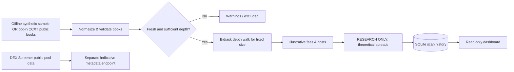

<div align="center">

# ArbiScope Pro
### Read-only CEX order-book intelligence & DEX liquidity research

**Price difference is not profit. Depth, fees, timestamps and risk matter.**


[](https://github.com/rajachanna/ArbiScope-Pro/actions/workflows/tests.yml)

**[Dashboard source](src/arbiscope/static/index.html) · [Pricing engine](src/arbiscope/engine.py) · [Tests](tests) · [Technical case study](docs/CASE_STUDY.md) · [Contact](https://nextgentechdev.com)**

</div>

---

## What the project demonstrates

A read-only analytics platform comparing **spot CEX order books** at an explicit base-asset trade size. It walks ask/bid depth instead of relying only on top-of-book prices, subtracts **illustrative configured fees** and optional estimated transfer costs, rejects unavailable depth and stale data, and explains why the result remains theoretical.

It also includes a separate **public DEX Screener pool research endpoint** for allowed chain/token-address pairs. DEX displayed prices and reported liquidity are **not executable swap quotes**; these are intentionally **not** mixed into calculated CEX net spreads.

The dashboard starts with an **offline, deterministic synthetic demo** that needs no API credentials or market connection. Real public spot order-book reads require explicit opt-in and CCXT installation. There is **no order creation, wallet connection, brokerage account access, arbitrage execution or guaranteed profitability**.

## Current capabilities

| Feature | What it shows | Status |
| --- | --- | --- |
| CEX order-book depth-aware quote estimates | Walk bids/asks for specified base quantity; reject insufficient depth | Implemented |
| Taker-fee assumptions, optional transfer-cost assumption | Estimated quote-currency theoretical net after chosen cost inputs | Implemented; **fees are assumptions**, not validated tier fees |
| Stale quote checks | Local receipt age and source timestamp age (if supplied) | Implemented; missing exchange timestamps flagged |
| Public read-only CEX adapters | CCXT spot order books from Binance, OKX, Bybit, Kraken, where publicly accessible | Implemented; availability varies by region/provider |
| Public DEX liquidity research | DEX Screener token-pairs endpoint, whitelist chain and token address | Implemented; **indicative only** |
| API and responsive research dashboard | Scan results, warnings, recent journal | Implemented |
| Reproducible synthetic demo | Fully offline demonstration and automated tests | Implemented |
| Telegram alert delivery | Not yet implemented | Planned |
| Exchange balances, trade execution, bridging, MEV protection | Not implemented | **Out of scope** |

### Why it is not an arbitrage trading bot

The scanner **does not check whether the same asset can be transferred between accounts or chains**. Its theoretical net may be positive even when withdrawing, depositing or execution is impossible. USDT differs from USD, prices can move between reads, and trading fee schedules vary. The calculated figures omit network gas (unless manually folded into transfer-cost assumptions), withdrawal/bridge reliability, transfer time, legal access, token taxes, market impact outside visible depth, exchange queue position, settlement and capital availability.

## Architecture



## Quick start

Python **3.11+**:

```bash
git clone https://github.com/rajachanna/ArbiScope-Pro.git
cd ArbiScope-Pro
python -m venv .venv
# macOS/Linux: source .venv/bin/activate
# Windows: .venv\Scripts\activate
python -m pip install -e '.[dev]'
uvicorn arbiscope.api:app --host 127.0.0.1 --port 8000
```

Open **http://127.0.0.1:8000** for the dashboard and **http://127.0.0.1:8000/docs** for the documented API. By default this always uses made-up prices in offline mode.

### Docker

```bash
cp .env.example .env
docker compose up --build
```

This binds port **8000 on localhost only**. SQLite scan history uses a persistent Docker volume. The base Docker image includes only the offline demo dependencies; if you wish to use public CCXT reads, install the optional live dependency in your chosen environment/build.

### Opt in to real **public** CEX order books

```bash
python -m pip install -e '.[live]'
export AS_ENABLE_LIVE_READS=YES
export AS_EXCHANGES=binance,okx,bybit
export AS_MARKET_SYMBOL=BTC/USDT
uvicorn arbiscope.api:app --host 127.0.0.1 --port 8000
```

PowerShell: `$env:AS_ENABLE_LIVE_READS="YES"`, then run Uvicorn. Supported scan pairs are `BTC/USDT`, `ETH/USDT`, `SOL/USDT` with same exact quote-currency. You may see provider errors because of network access, limits or exchange availability. No keys are requested.

### DEX research (separate endpoint)

After explicit live-read opt-in, call `GET /api/dex/pools?chain=solana&token_address=VERIFIED_ADDRESS` with an independently verified token mint. Allowed chains are `ethereum`, `solana`, `base`, `arbitrum`. The endpoint only returns qualifying *base-token* pools quoted against USDT/USDC, above a minimum reported liquidity threshold. It does not quote your trade size or route a swap.

## Verify the code

```bash
python -m pip install -e '.[dev]'
pytest -q
```

Unit tests cover depth walking, fees, stale/crossed books, limited liquidity, quote markets, read-only CCXT behavior, DEX response filtering, invalid addresses, demo safety, local history and scan cooldown. See **[the test suite](tests)** and **[GitHub Actions](.github/workflows/tests.yml)** for the actual run status.

## Client evaluation and technical services

- Read the [engineering case study](docs/CASE_STUDY.md) and [scope limitations](docs/SAFETY.md).
- Try the offline demonstration; inspect the API and numerical assumptions.
- Run the tests and verify GitHub Actions.
- Discuss a separately scoped production market-data integration, execution feasibility workflow, market monitoring dashboard or custom alerts.

**Developer: Raja Channa · NextGen Tech Solutions**  
**Website:** https://nextgentechdev.com  
**GitHub portfolio:** https://github.com/rajachanna

**License:** MIT. Trading and market-data use involve significant risks. This project is not investment advice, not an execution product and not a claim about realizable profit.
